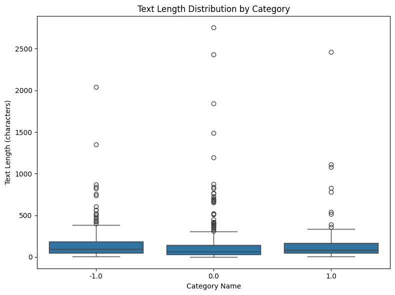
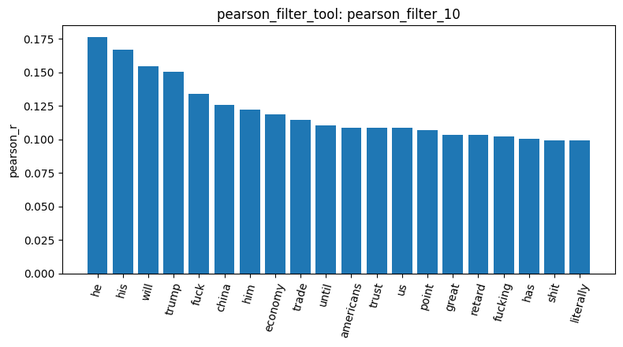
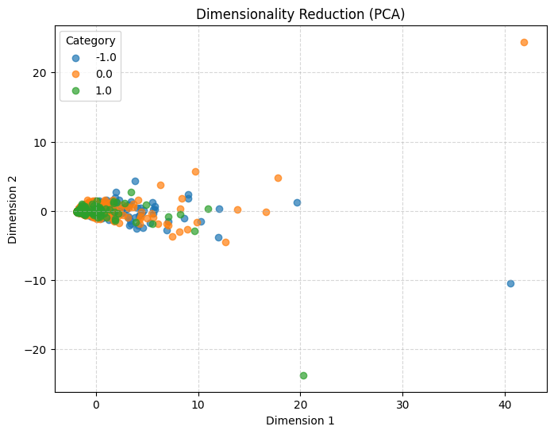

# DM2026 Lab 1 Homework Report
* **Student ID / Name**: `范祥彥_114065525`
* **Dataset Analyzed**: `newdataset/Reddit-stock-sentiment.csv`

---

## 0. Tool Authorization

Before executing the formal analysis pipeline, permissions were requested for the 18 workspace tools. Notably, `list_files_tool` was initially categorized under pre-granted tools, but during the batch authorization request, it was included alongside the other student tools. This review process covered state-mutating tools like `check_duplicates_tool` and `sample_data_tool`, ensuring the pipeline proceeded deliberately and step-by-step.

---

## 1. Data Inspection & Cleaning

* **Related Result IDs**: `load_dataset_1`, `inspect_data_2`, `check_missing_3`, `check_duplicates_4`, `check_duplicates_5`, `describe_data_6`

Loading the Reddit stock sentiment dataset via `load_dataset_tool` yielded an initial count of **847 documents** (Result ID: `load_dataset_1`), distributed across three sentiment categories:
* `"0.0"` (Neutral): 423 posts (~49.9%)
* `"-1.0"` (Negative): 315 posts (~37.2%)
* `"1.0"` (Positive): 109 posts (~12.9%)

The dataset exhibits class imbalance (the positive class accounts for only ~13%), which compresses the variance of minority indicators and impacts subsequent correlation and pattern mining thresholds.

Inspection via `inspect_data_tool` (Result ID: `inspect_data_2`) confirmed:
1. **Integer vs. String Labels**: `category_name` stores string labels (`"-1.0"`, `"0.0"`, `"1.0"`), whereas the integer `category` column maps to `0`, `1`, and `2`. `category_name` was consistently used to avoid ambiguity.
2. **Content Characteristics**: Texts contain WallStreetBets slang (e.g., `"Calls on retards"`) and market terms (e.g., `"Seeing lots of red in the ticker."` labeled as neutral).

`check_missing_tool` (Result ID: `check_missing_3`) confirmed **0 missing values**.

For duplicate detection, `check_duplicates_tool` (`drop=False`, Result ID: `check_duplicates_4`) identified **23 extra copies** (counted via `keep="first"`). Setting `drop=True` (Result ID: `check_duplicates_5`, utilizing `keep=False`) removed **34 rows** in total, reducing the document count from 847 to **813**.
* **Mathematical Derivation**: $\text{rows\_deleted} (34) - \text{duplicate\_count} (23) = 11$, indicating **11 distinct duplicated text templates**. Because `keep=False` removes all instances of duplicated texts (including the first occurrence), an extra 11 rows were removed.
* **Class Distribution Impact**: Of the 34 deleted rows, **32 belonged to the neutral class** ("0.0") (dropping from 423 to 391; negative remained at 315; positive dropped from 109 to 107). This distribution is consistent with template-style or automated market-update posts.

Text length statistics via `describe_data_tool` (Result ID: `describe_data_6`) showed standard deviations exceeding means across all categories (indicating severe right-skewness), so medians were used: negative posts had the longest median (**96.0 characters**, typically complaints/rants), followed by positive (**81.0 characters**), and neutral (**68.0 characters**, mostly short replies).

* **Text Length Distribution Boxplot**:

---

## 2. Document-Term Matrix & Term Frequency

* **Related Result IDs**: `build_dtm_7`, `term_frequency_8`

A critical design choice was made during DTM construction: scikit-learn's default English stop words list (`stop_words="english"`) strips out crucial sentiment-reversing negations like `"no"`, `"not"`, and `"never"`. To preserve sentiment cues, **`stop_words=None`** was selected alongside `min_df=1`.

Executing `build_dtm_tool` (Result ID: `build_dtm_7`) resulted in:
* **Matrix Shape**: $[813, 4,313]$ (813 documents, 4,313 terms).
* **Sparsity**: **`99.5249%`**, closely mirroring the `99.547%` sparsity observed in the 20-newsgroups pipeline. When comparing these two specific datasets, the sparsity remains remarkably similar, while the smaller vocabulary size in Reddit is likely due to fewer documents and shorter, more focused conversational text.

`term_frequency_tool` (Result ID: `term_frequency_8`) revealed that top-20 high-frequency terms were entirely generic function words (e.g., `"the"` [874], `"to"` [554], `"and"` [471]). It also successfully verified the alphabetical tie-breaking logic (e.g., `"for"` [209] preceding `"this"` [209] due to `f < t`).

---

## 3. Filtering & Correlation Analysis

* **Related Result IDs**: `variance_filter_9`, `pearson_filter_10`

Running `variance_filter_tool` (`threshold=0.01`, Result ID: `variance_filter_9`) kept **490 terms** (11.4%) and removed 3,823.
* **Mathematical Insight**: Certain rare terms (such as `"116"`, `"4271"`, likely concentrated in a single document) passed the threshold. Under the population variance formula $\text{Var}(X) = \frac{1}{N}\sum x_i^2 - \mu^2$, a term concentrated 3 times in a single document yields $\text{Var} \approx 0.01106 > 0.01$ (surviving), whereas a term appearing once across 8 distinct documents yields $\text{Var} \approx 0.00974 < 0.01$ (filtered out). This highlights how raw-count variance filters favor locally clustered terms.

`pearson_filter_tool` (targeting negative class `target_class="-1.0"`, Result ID: `pearson_filter_10`) evaluated all **4,313 terms** rather than just the 490 terms kept by the variance filter. This occurs because individual filter utilities in this architecture do not overwrite the global `feature_matrix`, allowing each step to perform an independent analysis.
* **Bar Chart Visualization**:

* **Analysis**:
  1. Top correlation coefficients $r$ were **all positive** (peaking at **$0.176$**), indicating terms frequently co-occurring in negative posts.
  2. Correlation magnitude was weak, driven by short post lengths and low term repetition.
  3. Terms clustered into WSB/macro themes: profanity (`"fuck"`, `"fucking"`, `"shit"`, `"retard"`), macroeconomics/geopolitics (`"trump"`, `"china"`, `"economy"`, `"trade"`), and pronouns.
  4. The positive word `"great"` appeared among top negative terms: manual inspection of negative posts containing `great` revealed **predominantly sarcastic or resigned usages** (e.g., `"Not great Bob"`, `"Great summary. We are hosed."`), explaining its positive correlation with the negative label.

---

## 4. Frequent Pattern Mining

* **Related Result IDs**: `mine_patterns_11`

For the smaller positive class (`"1.0"`, 107 posts), a proportional minimum support threshold of **`min_sup=3`** (representing roughly $2.8\%$ of the positive subset size) was applied using `filtering_method="tfidf"` and `algorithm="fpgrowth"` (Result ID: `mine_patterns_11`), retaining 832 terms.
* **Findings**:
  1. The top 20 patterns were **entirely 1-itemsets** (e.g., `['just']` [15], `['good']` [12], `['hold']` [4]), reflecting low co-occurrence probability in short texts.
  2. **Topic Overlap**: Macro topics like `"economy"`, `"tariffs"`, and `"market"` surfaced in both positive and negative classes, indicating shared macro themes whose sentiment polarity depends on context rather than topic alone.
  3. **Architectural Contrast**: `mine_patterns_tool` internally utilizes English stop words (stripping negations), providing an interesting point of contrast with our DTM setup (`stop_words=None`).

---

## 5. Dimensionality Reduction (PCA)

* **Related Result IDs**: `reduce_pca_12`

`reduce_dimensions_tool` (`method="pca"`, Result ID: `reduce_pca_12`) projected the DTM into 2D space:
* **Explained Variance**: PC1 accounted for $26.70\%$ and PC2 for $5.12\%$ (cumulative **$31.82\%$**), lower than the 20-newsgroups pipeline ($70.27\%$ ), reflecting more dispersed text variation.
* **Outlier Analysis**: The three most extreme outliers (one per class) appear consistent with the longest documents in `describe_data_6` (neutral: 2753, positive: 2461, negative: 2040 chars), suggesting PC1 is likely driven by document length.
* **Sentiment Overlap**: Categories heavily overlapped near the origin, showing linear unweighted features cannot easily separate fine-grained sentiment polarities.

* **PCA Scatter Plot**:

---

## 6. Cosine Similarity Exploration

* **Related Result IDs**: `cosine_similarity_13`, `cosine_similarity_14`

Un-deleted document pairs from the first 5 rows were tested:
1. **Intra-class Comparison (Doc Index 0 vs 4, both negative `"-1.0"` Text: `"Calls on retards"` vs `"He didn’t say thank you."`)**:
   * **Result**: Cosine = **`0.0`** (Result ID: `cosine_similarity_13`).
   * **Interpretation**: Zero vocabulary overlap, demonstrating that BoW cosine similarity measures exact token overlap rather than semantic/sentiment closeness.
2. **Cross-class Comparison (Doc Index 0 negative vs Doc Index 3 positive promotional post)**:
   * **Hypothesis**: Despite opposite sentiments, retaining stop words (`stop_words=None`) shares generic function words like `"on"` (`"Calls on"` vs `"on water"`), yielding a non-zero similarity.
   * **Result**: Cosine = **`0.0585`** (Result ID: `cosine_similarity_14`).
   * **Interpretation**: The cross-sentiment pair showed higher similarity than the intra-sentiment pair, empirically validating the hypothesis and highlighting the impact of stop words on distance metrics in short texts.

---

## 7. Conclusion & Limitations

This lab successfully navigated the Reddit stock sentiment pipeline through 14 tool executions and logical deductions:
* **Key Insights**: Social media short texts exhibit high sparsity, extreme right-skewed term frequencies, and sarcastic slang. BoW and linear PCA are heavily influenced by document length and high-frequency function words.
* **Future Improvements**:
  1. Incorporate TF-IDF weighting to downweight global function words.
  2. Implement custom stop-word lists that filter generic terms while strictly preserving negations (`"no"`, `"not"`).
  3. Adopt embedding-based or semantic retrieval models to overcome zero-overlap limitations in sparse Bag-of-Words spaces.

---

## 8. AI Use Statement
* **AI Assistance Disclosure**: Claude (Anthropic) was used throughout the lab as a tutor: explaining concepts, reviewing the coding agent’s proposals, and suggesting directions for follow-up questions. Gemini was used to help structure and polish the English of this report. All numbers and result IDs come from the logged tool outputs; interpretations were discussed with AI assistance and checked by the student against the actual results.
